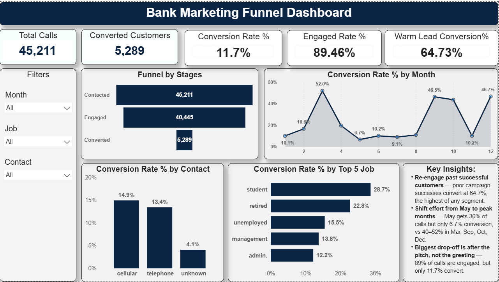
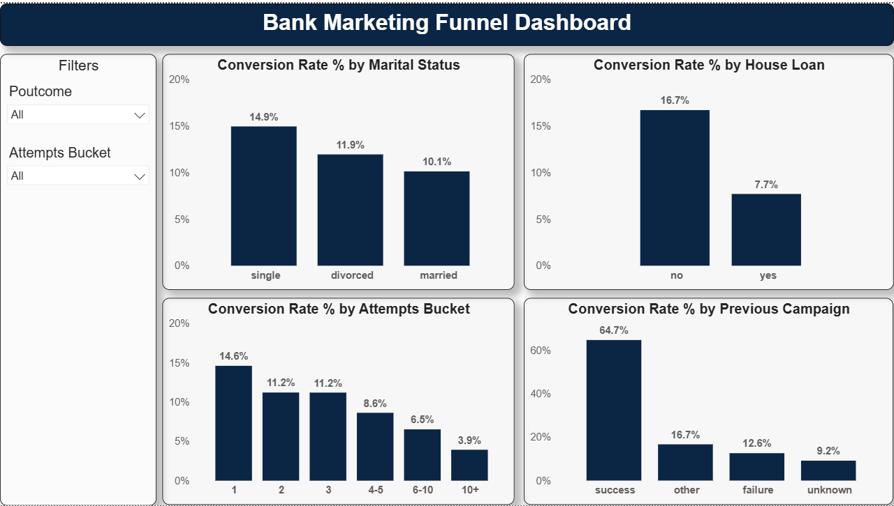

# 📊 Bank Marketing Funnel Dashboard

An interactive **Power BI dashboard** built using the UCI Bank Marketing dataset.
The project analyzes a Portuguese bank's telemarketing campaign to understand **where customers drop off, which channels and segments convert best, and how the bank can improve its call strategy**.

---

## 🚀 Project Overview

This project turns raw call-log data into a funnel analysis and an interactive business intelligence dashboard.

The data was cleaned and transformed in **Python (pandas)**, then loaded into **Power BI** where DAX measures and interactive visuals were built to identify drop-off points and high-value customer segments.

### Project Flow

```text
Raw UCI Bank Marketing Dataset (bank-full.csv)
       ↓
Python (pandas)
(Data Cleaning & Feature Engineering)
       ↓
Power BI Data Model
       ↓
DAX Measures / KPIs
       ↓
Interactive Dashboard
       ↓
Business Insights & Recommendations
```

---

## 🎯 Business Objectives

The dashboard was designed to answer questions such as:

- Where do customers drop off between being contacted and converting?
- Which contact channel brings the highest-quality leads?
- Which months convert best, and where is call effort being wasted?
- Which customer segments (job, marital status, housing loan) are most likely to convert?
- Does calling the same customer repeatedly help or hurt conversion?
- Are customers with a successful previous campaign worth re-contacting?

---

## 🛠️ Tools & Technologies

- **Python** (pandas) — data cleaning and feature engineering
- **Power BI**
- **DAX** — KPI and conversion-rate measures
- Data Cleaning & Transformation
- Data Visualization
- Business Intelligence / Marketing Analytics

---

## 🧹 Data Cleaning & Preparation

The raw dataset (45,211 rows, 17 columns) was cleaned in Python before building the dashboard.

Steps included:

- Converting the target column `y` (yes/no) into a numeric `converted` flag (1/0)
- Keeping `unknown` values as their own category instead of dropping them (they make up a large share of `poutcome` and `contact`)
- Creating a `Month Number` column and sorting `month` chronologically (Jan → Dec)
- Bucketing `campaign` (number of contact attempts) into readable ranges: 1, 2, 3, 4–5, 6–10, 10+
- Flagging calls longer than 60 seconds as **Engaged**, to build a Contacted → Engaged → Converted funnel

**Note on two source files:** `bank.csv` (4,521 rows) is a 10% sample used only for quick testing. All analysis and the dashboard use the full `bank-full.csv` (45,211 rows).

---

# 📈 Dashboard Features

## Page 1 — Overview, Channel & Time

- **KPI cards:** Total Calls, Converted Customers, Conversion Rate %, Engaged Rate %, Warm Lead Conversion %
- **Funnel chart:** Contacted → Engaged → Converted
- **Conversion Rate % by Contact channel**
- **Conversion Rate % by Month**
- **Conversion Rate % by Top 5 Job**
- **Key Insights** panel

## Page 2 — Segments & Effort

- **Conversion Rate % by Marital Status**
- **Conversion Rate % by House Loan**
- **Conversion Rate % by Attempts Bucket** (number of times a customer was called)
- **Conversion Rate % by Previous Campaign outcome (poutcome)**

## 🎛️ Interactive Filters

Slicers included: **Month, Job, Contact channel, Poutcome, Attempts Bucket** — allowing dynamic exploration of the funnel and conversion rates for any combination of filters.

---

# 📊 Key Metrics

| Metric | Value |
|---|---|
| Total Calls | 45,211 |
| Converted Customers | 5,289 |
| Conversion Rate | 11.7% |
| Engaged Rate (calls > 60s) | 89.46% |
| Warm Lead Conversion Rate (poutcome = success) | 64.73% |

---

# 💡 Key Insights

1. **Engagement is high, conversion is not** — 89% of calls last long enough to count as "engaged," but only 11.7% convert. The biggest drop-off happens *after* the call connects, not during the greeting.
2. **Past success predicts future success** — customers with a successful previous campaign convert at **64.7%**, more than 5x the average.
3. **Effort is misallocated by month** — May receives ~30% of all calls but converts at only **6.7%**, while March (52.0%), September (46.5%), October (43.8%) and December (46.7%) convert far better on much lower volume.
4. **Cellular outperforms other channels** — cellular calls convert at 14.9% vs. 4.1% for calls with an unrecorded ("unknown") channel.
5. **Job and loan status matter** — students (28.7%) and retirees (22.8%) convert best; blue-collar workers (7.3%) convert worst. Customers without a housing loan convert more than twice as often as those with one (16.7% vs. 7.7%).
6. **Diminishing returns on repeat calls** — conversion falls steadily from 14.6% (1st attempt) to 3.9% (10+ attempts).

---

# 💼 Recommendations

1. **Re-contact past successful customers first** — this is the highest-converting segment by a wide margin (64.7%).
2. **Reallocate call volume away from May** toward March, September, October and December.
3. **Prioritize the cellular channel** and start recording the contact channel for every call to close the "unknown" tracking gap.
4. **Cap outreach at 3–5 attempts per customer** — conversion drops sharply beyond this point.
5. **De-prioritize customers who already hold a housing loan** in favor of loan-free customers.
6. **Review and strengthen the sales pitch used after the call connects**, since engagement is not the bottleneck — the pitch is.

---

# 💼 Business Use Cases

This dashboard can support:

### Campaign Planning
Identifying high-converting months and reallocating call volume accordingly.

### Lead Prioritization
Scoring and prioritizing leads based on channel, job, loan status and campaign history.

### Call Strategy
Setting attempt limits and improving the pitch used after a call connects.

### Performance Monitoring
Tracking conversion rate, engagement rate and warm-lead conversion over time.

---

# 🖥️ Dashboard Preview




---

# 🔍 Project Highlights

- Cleaned and engineered features from raw call-log data using **Python (pandas)**
- Built a **3-stage funnel** (Contacted → Engaged → Converted) to pinpoint drop-off
- Built an interactive **Power BI dashboard** across two pages
- Created business-focused **DAX measures and KPIs**
- Analyzed conversion by channel, month, job, marital status, housing loan, attempts and previous outcome
- Added **synced slicers** for dynamic, cross-page filtering

---

# 📌 Conclusion

The campaign's overall 11.7% conversion rate hides large, addressable gaps by month, channel and customer history. Re-engaging customers who converted before and reallocating effort away from low-converting months like May are the two highest-leverage, lowest-cost changes the bank can make. Longer term, consistently recording the contact channel and revisiting the sales pitch used after a call connects would close the remaining gaps identified in this analysis.

---

## 👨‍💻 Skills Demonstrated

`Python` `pandas` `Power BI` `DAX` `Data Cleaning` `Data Transformation` `Data Visualization` `Business Intelligence` `Marketing Analytics` `Funnel Analysis` `KPI Development` `Interactive Dashboard`

---

## 👨‍💻 Author

Narendra Kumar
